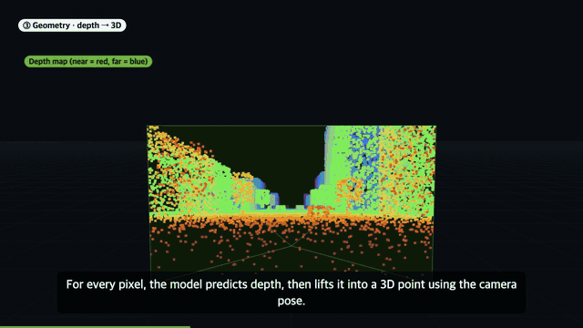
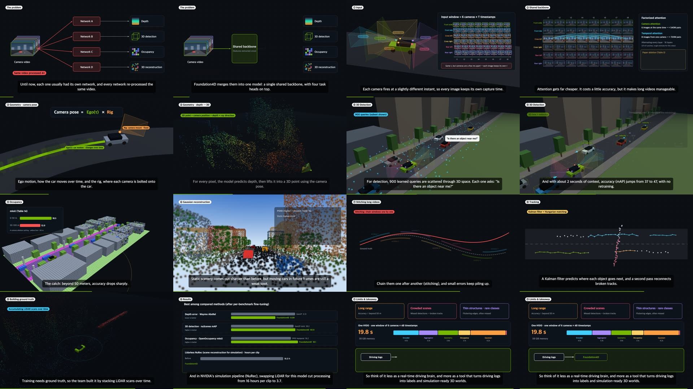

# paper2video

A Claude Code plugin (one skill, `/paper2video`): arXiv paper in, narrated and fact-checked explainer video out.

```
/paper2video https://arxiv.org/abs/2610.30340
```



*Clips from the bundled example: a 4.5-minute explainer of NVIDIA's [Foundation4D](https://arxiv.org/abs/2610.30340) (CC BY 4.0), made end to end by this skill.
All visuals are generated; every on-screen number traces back to a quote or table row in the paper.*

<details>
<summary>All 14 scenes (contact sheet)</summary>



</details>

- **Scenes:** Three.js (3D) + canvas (2D), timed to the narration; reusable templates plus custom scenes per paper
- **Narration:** English by default (Kokoro, local, Apache-2.0); Korean and 30 other languages with `ko`, `ja`, ... (Supertonic 3, local, OpenRAIL-M). No API keys
- **Cross-check:** every number and claim is tied to a quote or table row in the paper and checked mechanically against the paper text and against every string the renderer actually drew (`scripts/check_claims.py`), then by an independent verifier subagent (`references/verification.md`)
- **Output:** 1080p30 MP4, contact sheet, verification report. It never uploads or posts anything.

## Install

Tested so far with Claude Opus 5.5 at medium effort; other models and effort levels have not been tried yet.

Requires Claude Code, git, Node 18+, Python 3.10-3.13 and about 1 GB of disk (Option B also uses curl). macOS or Linux; Korean videos on Linux need Noto Sans CJK.

**Option A: plugin (recommended).** In any Claude Code session:

```
/plugin marketplace add SunandBean/paper2video
/plugin install paper2video@sunandbean
```

That's it. The first `/paper2video` run installs the tools (Node packages, ffmpeg, headless Chromium, Python venv, voice model; a few minutes, once).
Updates: `/plugin marketplace update sunandbean`, or turn on auto-update for the marketplace in `/plugin` → Marketplaces.

**Option B: one-line script.** In a terminal:

```bash
curl -fsSL https://raw.githubusercontent.com/SunandBean/paper2video/main/install.sh | bash
```

This clones into `~/.claude/skills/paper2video` and installs the tools right away. Run the same line again to update.

Either way, your jobs and finished videos live in `~/paper2video/` and survive updates. The tools live separately
(plugin data folder for A, `.tools/` inside the clone for B), so updating never re-downloads the 1 GB toolchain.

## Use

In any Claude Code session:

```
/paper2video <arxiv link or id> [overrides]
/paper2video 2610.35607 3 min, voice am_michael
/paper2video 2610.35607 한국어
```

The skill only runs when you call it (`disable-model-invocation: true`); pasting a paper link in a normal chat does nothing special.

Finished videos appear in `~/paper2video/videos/` with readable names (e.g. `2610.30340_Foundation4D.mp4`); working files stay in `~/paper2video/jobs/<id>/`.
Override with `P2V_HOME` (both), `P2V_OUT` (videos) or `P2V_JOBS` (jobs).

Everything the skill does is also a terminal command, `p2v` in the skill folder:

```bash
p2v doctor                 # folders and what is installed
p2v smoke [--ko]           # toolchain test, should end with ALL PASS
p2v test                   # fast regression tests for the checker and the local server
p2v run <arxiv link>       # unattended run through `claude -p` (for cron or another bot)
p2v help                   # fetch, check, tts, preview, render, collect, setup
```

## What's inside

- `SKILL.md` workflow and defaults the agent follows
- `engine/` timeline player, 3D/2D primitives, templates
- `p2v` single command for every step; `scripts/` fetch (with license detection), TTS, claims check, render/mux
- `.claude-plugin/` plugin and marketplace manifests; `install.sh` for the git-clone route
- `references/` verification layers, scene authoring, licensing
- `local/` optional, git-ignored: put your own extra steps here (e.g. a publishing checklist); the skill runs them after its final report
- `jobs/2610.30340/` worked example (Foundation4D, NVIDIA, CC BY 4.0), `jobs/_smoke/`, `jobs/_smoke_ko/` toolchain tests

License: MIT (see LICENSE). The example job includes text from the Foundation4D paper (arXiv 2610.30340, NVIDIA, CC BY 4.0).

Third-party: three.js (MIT), ffmpeg-static (downloads a GPL-3.0 FFmpeg build at install), kokoro-onnx (MIT) and Kokoro-82M weights (Apache-2.0), supertonic (MIT code, Supertonic 3 weights under OpenRAIL-M), Playwright (Apache-2.0).
Korean subtitles need a Korean font (built into macOS; on Linux install Noto Sans CJK).
